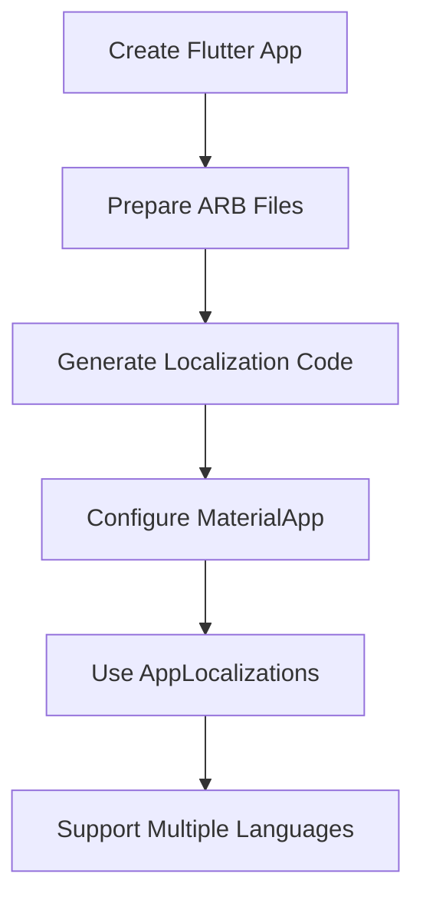

# Localization & Globalization in Flutter

## 1. Introduction

When building a mobile application, we should consider users who speak different languages and live in different regions.

Two important concepts help us achieve this:

- **Globalization (G11n)**
- **Localization (L10n)**

## 2. What is Globalization?

Globalization is the process of designing an application from the beginning so that it can support different languages, regions, and cultures.

**Example:**

An application designed to support:
- Arabic and English.
- Right-to-left (RTL) and left-to-right (LTR) layouts.
- Different currencies.
- Different date and number formats.

## 3. What is Localization?

Localization is the process of adapting an application to a specific language and region.

**Example:**

When a user selects Arabic:
- "Welcome" becomes "أهلاً بك".
- The layout changes to RTL.
- Dates and numbers follow the appropriate regional format.

## 4. Globalization vs Localization

| Globalization | Localization |
|---|---|
| Preparing the app for different regions | Adapting the app to a specific region |
| A design and architecture approach | An implementation process |
| Supports future expansion | Provides the actual translated experience |

## 5. Localization in Flutter

Flutter provides built-in localization support through several tools.

### Important tools

- **ARB Files:** Files containing translated strings.
- **flutter_localizations:** Provides localized Flutter widgets.
- **intl:** Helps format dates, numbers, and currencies.
- **AppLocalizations:** Generated Dart class used to access translations.
- **l10n.yaml:** Configuration file for Flutter localization generation.

### Example project structure

```text
lib/
 ├── l10n/
 │    ├── app_en.arb
 │    └── app_ar.arb
 └── main.dart

l10n.yaml
```

### English translation – app_en.arb

```json
{
  "appTitle": "Global Services",
  "welcome": "Welcome",
  "settings": "Settings"
}
```

### Arabic translation – app_ar.arb

```json
{
  "appTitle": "الخدمات العالمية",
  "welcome": "أهلاً بك",
  "settings": "الإعدادات"
}
```

### Accessing translations in Flutter

```dart
final lang = AppLocalizations.of(context)!;

Text(lang.welcome);
```

## 6. RTL and LTR

- **RTL:** Right to Left, used in Arabic.
- **LTR:** Left to Right, used in English.

For flexible layouts, prefer directional properties:

```dart
EdgeInsetsDirectional.only(
  start: 16,
  end: 16,
)
```

Instead of relying on fixed left and right values.

## 7. Generating Localization Files

After preparing ARB files, run:

```bash
flutter gen-l10n
```

Flutter generates Dart localization code that can be used inside the application.

## 8. Translation Management Platforms

These platforms help teams manage translations:

- **Localizely:** Manage translations and ARB files.
- **Crowdin:** Collaborate with translators.
- **Lokalise:** Manage localization workflows.

### What is OTA?

OTA means Over The Air.

It allows supported updates, such as translations, to be delivered to the application over the internet without publishing a new store version for every translation change.

OTA does not mean downloading new Dart code or changing the application's business logic.

## 9. Localization Workflow



## 10. Why is Localization Important?

1. Improves user experience.
2. Makes the application accessible to more users.
3. Supports international expansion.
4. Makes the application easier to maintain and extend.

## 11. Key Takeaways

- Globalization prepares the application for different regions and cultures.
- Localization adapts the application to a specific language and region.
- ARB files contain translated strings.
- Flutter generates localization code from ARB files.
- RTL and LTR are important for multilingual layouts.
- OTA can update supported translation content without a store release.

## 12. Useful Resources

- [Flutter Internationalization Documentation](https://docs.flutter.dev/ui/accessibility-and-internationalization/internationalization)
- [Dart intl Package](https://pub.dev/packages/intl)
- [Markdown Guide](https://www.markdownguide.org/)
